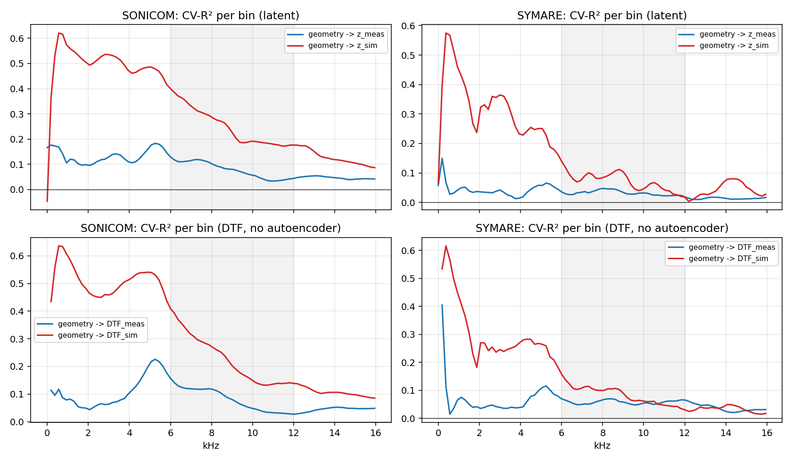
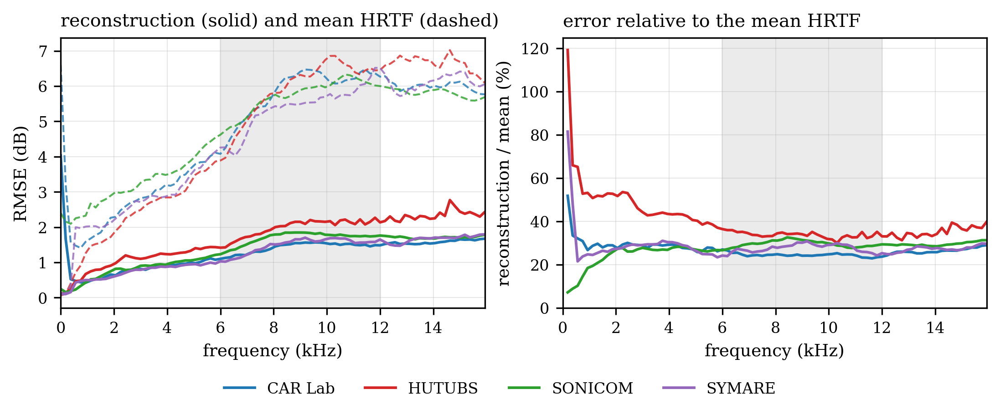

# Predicting Individual HRTFs from Head and Ear Geometry

Capstone thesis project, ELEC5021, University of Sydney, 2026 (CAR Lab; supervisor Prof. Craig Jin).
Thesis: *Predicting Individual Measured HRTFs from Head and Ear Geometry with a Multi-Database Spherical Autoencoder*.

A head-related transfer function (HRTF) describes how a listener's head and ears filter sound arriving from each
direction. Binaural audio uses it to place a sound at a chosen direction, and because it differs from person to
person, the best results need the listener's own HRTF. Measuring one requires an anechoic chamber and specialised
equipment. This project asks how much of an individual's measured HRTF can be predicted from a 3-D scan of their
head and ears instead.

## Results

| Question | Result |
|---|---|
| Can one model represent the HRTFs of four databases? | Yes. A spherical autoencoder trained on 774 subjects reconstructs held-out measured HRTFs to 1.46 dB RMSE, against 4.81 dB for the mean HRTF of the training subjects (70% lower). |
| How well does head and ear geometry predict a new person's measured HRTF? | Detectably, but only a little. On 36 held-out subjects, evaluated once, the log-spectral distortion (LSD) is 3.1% below that of the population-mean HRTF (−0.134 dB, 95% CI [−0.204, −0.068], one-sided p = 0.00025). |
| Does the person's own acoustic simulation help? | When a learned regression maps it to the measurement, yes: 6.4% below the mean. Used directly in place of a measurement, it is 27% worse than the mean. A published sim-to-real method (S2RNF, Interspeech 2026) reports 3.0% below its own mean on the same database. |
| Why is the gain so small? | Below 5 kHz, the measured HRTFs vary between people about three times as much as their simulations, and the scan does not explain the extra variation. Above 6 kHz, even the simulations are poorly predicted from these features with this number of subjects. |



*Cross-validated R² per frequency for predicting the simulated (red) and the measured (blue) HRTF of the same
subjects from the same geometry features. Left: SONICOM; right: SYMARE. Top: the autoencoder latent; bottom: the
directional transfer function, without the autoencoder.*



*Reconstruction error of the 48 kHz autoencoder by frequency and database on validation subjects (solid), against
the mean HRTF of the training subjects (dashed); right, the ratio of the two.*

## What the project contains

- **Spherical autoencoder** (PyTorch). HRTFs on the HEALPix sphere (3072 directions), OSLO spherical convolutions,
  Fourier-feature frequency conditioning and per-database FiLM; a latent of 64 values per frequency.
  `notebooks/FFM48k_Train.ipynb`
- **Multi-database data pipeline.** SOFA and MATLAB readers, a reverse-engineered binary format for the lab's
  archive, and spherical-spline interpolation onto HEALPix, at 44.1 and 48 kHz, with checks on every subject.
  `preprocess_48k/`, `analysis/`
- **Geometry to HRTF.** Random-Fourier-feature embeddings of 3-D meshes and landmarks with kernel ridge regression;
  PointNet, an MLP and a graph network on the whole head mesh as more flexible alternatives. `mesh2z/`, `landmark2z/`
- **Diagnostics.** The same regression on boundary-element simulations, a torso check, within-person comparisons and
  shape–HRTF modes. `task1/`, `task2/`, `mesh2z/`
- **Evaluation discipline.** Subject-grouped cross-validation; every result compared with the population-mean HRTF
  of the same subjects; analyses and stopping rules registered before each run; held-out test sets scored once; a
  dated log with a register of the project's own errors and how each was caught. `docs/PROJECT_LOG.md`

**Tools.** Python, PyTorch, NumPy, SciPy, scikit-learn, healpy, h5py, Matplotlib, Google Colab (A100 GPU).

**How it was built.** Much of the code, in particular for the later experiments, was written with AI coding
assistants (Claude Code, and Codex for one experiment) at my direction. I set the research questions, chose the
designs, ran the experiments and checked every result; see `docs/PROJECT_LOG.md` §7 and §7A.

## Data and privacy

No measured data, meshes or model weights are included. HUTUBS, SONICOM and SYMARE are public and can be downloaded
from their original sources (`docs/DATA.md`); the CAR Lab archive is unpublished laboratory data and is not
distributed. Subject IDs such as `CL001` are pseudonyms. The project log omits the supervisor meeting notes, private
correspondence and unpublished laboratory plans (see its first lines).

---

# Development notes

The sections below are the working notes as written during August–October 2026, including the earlier 44.1 kHz
models. Where they differ from the results above, the results above and the thesis are the later ones.

## Autoencoder validation results (FFM26, September 2026)

Magnitude spectra: 93 frequency bins at $\Delta f = f_s/256 = 172.27$ Hz (DC to 15.85 kHz),
HEALPix `nside=16` (3072 directions). Each sample is one ear; right ears are mirrored
across the median plane into a left-ear frame.

| Configuration | Subjects | Epochs | Val RMSE | Baseline | Reduction |
|---|---:|---:|---:|---:|---:|
| Four databases, pooled (`FFM26`) | **774** | 100 | **1.4855 dB** | — | — |
| — CARLab partition | 218 | 100 | **1.3483 dB** | 5.053 dB | 73.3% |
| — HUTUBS partition | 96 | 100 | 1.8345 dB | 5.162 dB | 64.5% |
| — SONICOM partition | 399 | 100 | 1.4545 dB | 4.977 dB | 70.8% |
| — SYMARE partition | 61 | 100 | 1.3261 dB | 4.805 dB | 72.4% |

Baselines are the per-database mean-HRTF predictor. Two conventions define it and both
matter: the mean spectrum is built from that database's **training ears only** — a mean
that has seen the validation subjects is a leak, not a prior — and it is scored on the
**same partition as the model figure beside it**, with the same pooled RMSE, so the
reduction column is a ratio of comparable quantities. There is deliberately no pooled
baseline across databases: level conventions differ, so a mean taken across them is a poor
predictor for all four.

These are **validation** results from the four-database `FFM26` checkpoint (epoch 99). The
held-out test set has 242 ears — 44 CARLab, 48 HUTUBS, 120 SONICOM and 30 SYMARE — and was
evaluated once, on 2026-10-07 (1.46 dB against 4.81 dB; see Results above). The saved comparison output confirms that adding SYMARE does not
materially change the three pre-existing validation partitions (v2.6 minus v2.3: CARLab
−0.0237 dB, HUTUBS +0.0215 dB, SONICOM +0.0005 dB). Those tiny validation differences do
not support a claim that pooling improves reconstruction; they support the narrower claim
that all four heterogeneous databases can be represented together with per-frequency FiLM.

**Where the residual error is (v2.3 diagnostic).** The saved per-band diagnostic below is
from the earlier three-database test model, retained because the four-database notebook has
not yet run its guarded test or per-band evaluation. It is not a `FFM26` test result.
Within DC–15.85 kHz, its residual as a fraction of the per-band baseline was:

| Band | residual / baseline |
|---|---|
| DC and < 500 Hz | 59.3% — worst |
| 0.5–6 kHz | ~40% |
| **6–12 kHz (pinna notches)** | **25.3% — best** |
| 12–16 kHz | ~35% |

Within this band the 6–12 kHz notch band is the one the earlier autoencoder reproduced
*best*. Re-run the corresponding diagnostic after the `FFM26` test evaluation before making
the same claim for the four-database model.
The following amortisation diagnostic is likewise from the earlier three-database model: its
gap (encoder output versus a per-subject optimised latent) is 0.072 dB, i.e. 5.1%.
**The autoencoder was not the bottleneck in that diagnostic.** In the corrected 61-subject sparse-landmark
study, geometry–latent dependence is detectable but small: the best development CV-R² is
0.0845, below the pre-specified 0.10 stopping threshold. See
[`docs/landmark2z/RESULTS_RFF_2026-09-05.md`](docs/landmark2z/RESULTS_RFF_2026-09-05.md).

**Band caveat.** Every figure above is confined to DC–15.85 kHz. The earlier 48-subject model
ran to 24 kHz, so the two are not directly comparable, and nothing here tests how the model
behaves on notch structure above 16 kHz — see `docs/PROJECT_LOG.md`, entry 2026-08-23.

---

## Repository map

```
notebooks/
  FFM_2_6_2QuadDB.ipynb           current training notebook — 4 databases, FFM + FiLM
  FFM_2_3_MultiDB.ipynb          superseded 3-database predecessor
  Compute_Baselines.ipynb        per-database mean-HRTF baselines, val and test (no model, no GPU)
  HRTF_DupCheck.ipynb            duplicate audit + SYMARE↔CARLab subject correspondence
  Check_Direction_Alignment.ipynb
  archive/                       superseded notebooks, kept for provenance
src/
  oslo_fast.py                   OSLO conv with a gather-based backward (see below)
  FFM_2_3_cell*.py               standalone copies of the notebook's cells
preprocess_48k/                  48 kHz data pipeline (2026-10-10): preprocess, verify, pack — see its README
analysis/                        one script per question — see the table below
  spherical_spline.py            the STPS -> HEALPix projection every export path uses
  preprocess_multidataset_stps.py  SOFA/.mat -> HEALPix reader for SYMARE, HUTUBS, SONICOM
  _paths.py                      resolves the data root ($ELEC5021_ROOT, else ../..)
  archive/                       superseded scripts, kept for provenance
results/                         current figures and CSVs
results/archive/                 metrics of two legacy FFM23 test volumes (figures not included)
docs/PROJECT_LOG.md              full dated log, corrections register, open actions
docs/DATA.md                     where the data lives, and how each archive was made
docs/landmark2z/                 corrected landmark→latent / RFF protocol and results
landmark2z/                      executable corrected landmark→latent notebooks
```

## What is in `results/`

Small figures and CSVs, plus the metrics of **two legacy demonstration volumes of the
per-subject error maps** from the earlier three-database (`FFM23`) frozen TEST run. The
per-subject figures of those volumes are not part of this public snapshot:

| Folder | Contents |
|---|---|
| `results/archive/bandmaps_test_0828_0914_CARLab_part1of2/` | 43 CARLab test ears |
| `results/archive/bandmaps_test_0828_0914_SONICOM_part2of3/` | 43 SONICOM test ears |

These are legacy FFM23 samples, **not FFM26 evidence**. They remain for provenance and
for inspecting the visualisation convention; they must not be substituted for a later FFM26
validation or final-test export. The complete FFM23 run is 212 ears x 20 figures = 4240 PNG
(about 760 MB) and is not committed. Everything needed to read its *numbers* is committed:
each volume carries the full `_ALL_subject_errors.csv` (all 212 ears, all three databases)
and the `_LOCKED_metrics.txt` for the whole test run, not only for its own subset.

Inside a volume:

```
_LOCKED_metrics.txt      the scalar TEST result, written BEFORE any figure was drawn
_ALL_subject_errors.csv  all 212 ears: rmse_band, rmse_all, lsd, mae, bias, rmse_notch, peak
_README.txt              what each metric column means, and why the two means differ
<DB>/<subject>_<ear>/       (not in the public snapshot)
    band_00 ... band_18 .png   Mollweide GT / prediction / |error| per 861 Hz band
    zz_error_vs_frequency.png  RMS error and signed bias against frequency
    zz_summary.txt             that ear's scalars plus its per-band RMS error
    zz_errors.json             the same numbers, machine-readable
```

`_LOCKED_metrics.txt` and `_README.txt` are English; the Chinese originals are kept beside
them as `*.zh.txt`.

**Record before observe.** `_LOCKED_metrics.txt` is written by the same cell that draws the
figures, *before* the first figure — so inspecting the maps cannot influence the number that
gets reported. If inspection ever leads to a model change, the log says so, the model is
retrained, and the old number is void rather than one of two to choose from.

**Two conventions that are easy to confuse.** The pooled figure is the *quadratic* mean over
ears, so it always exceeds the arithmetic mean:

| Quantity | Value |
|---|---:|
| arithmetic mean of per-ear `rmse_band` | 1.4716 dB |
| quadratic mean of per-ear `rmse_band` = pooled test RMSE | **1.4867 dB** |
| standard deviation across 212 ears | 0.2116 dB |
| best / worst ear | 0.964 (CL069) / 2.016 (HU_pp93) |

`lsd` instead takes the RMS over frequency first and only then an *arithmetic* mean over
directions, which makes it systematically the smallest of the three. It is the column to use
when comparing against figures quoted in other papers.

## Model weights

Weights are **not** in the repository: `.pth` is ignored by `.gitignore`, and both files
exceed GitHub's 100 MB per-file limit in any case.

| File | Size | Where |
|---|---:|---|
| `FFM26_best.pth` | 386 MiB | not published here; available on request |
| `FFM23_best.pth` | 386 MiB | earlier three-database checkpoint; retained for the archived test artifacts |
| `FFM23_latest.pth` | 1.21 GB | not published - optimiser state, only needed to resume training |

`FFM26_best.pth` is the current checkpoint behind the four-database validation results above:
epoch 99, pooled validation RMSE 1.4855 dB. Its SHA-256 is
`ea3c4a5f667ba30dafb0ff4167bcfffa8d4a738eec39146e17f7ada7ad4a5108`.
Download it into the directory named by `config['save_dir']`; `FFM_2_6_2QuadDB.ipynb` rebuilds
the frozen partitions from the split stored inside the checkpoint. Evaluation and figure
cells need no GPU.

## What each script answers

| Script | Question | Headline result |
|---|---|---|
| `analysis/band_limit_audit.py` | Is CARLab's 16 kHz ceiling a measurement limit or a filter? | **A filter.** 259/259 archives cliff at 16 312.5 Hz; the raw 80 kHz recordings hold 38–40 dB SNR from 16–24 kHz |
| `analysis/bem_vs_measured.py` | How far is SYMARE's BEM from measurement? | 6.28 dB, but $R^2 = 0.54$ of individual variation |
| `analysis/hrtf_svd_rank.py` | Intrinsic dimensionality of the data itself | Held-out floor 3.26 dB; 4→24 dims, low→high frequency |
| `analysis/FFM_2_1_amort_fast.py` | Encoder or decoder? | Gap 0.072 dB (5.1%); cold−warm 0.005 dB |
| `analysis/FFM_2_1_diagnostics.py` | Which band carries the error? | Notch 6–12 kHz best at 25.3%; DC and <500 Hz worst at 59.3% |
| `analysis/latent_variance_decomp.py` | What does the latent encode? | 71.7% = which ear; 18.6% = which person |
| `analysis/latent_diagnostics_v2.py` | Effective dimensionality | 33 of a 47 ceiling (left ears) |
| `analysis/freq_budget_ceiling_v2.py` | Does frequency-wise capacity reallocation help? | +0.08 dB, versus +0.80 dB from more total capacity |
| `notebooks/FFM_2_6_2QuadDB.ipynb` | Does a four-database AE include SYMARE without degrading validation? | 774 subjects; pooled val 1.4855 dB; SYMARE val 1.3261 dB against 4.805 dB baseline |
| `landmark2z/FFM_2_8_Landmark2Z.ipynb` | Is a correctly matched subject's latent dependent on sparse landmarks? | **Yes, detectably:** dCor²ᵤ = 0.0710, p = 0.0020 (N = 61); predictive magnitude is assessed in `2_9` |
| `landmark2z/FFM_2_9_RFF_MLP.ipynb` | Do raw coordinates, per-landmark RFF or an MLP predict the latent? | **No useful unseen-subject prediction:** best development CV-R² = 0.0845; stopping rule triggered |
| `analysis/FFM_2_3_bench_kernels.py` | Where does training time go? | OSLOConv backward = 14.1× forward, 92% of the epoch, 0.2% of A100 BF16 peak |
| `src/oslo_fast.py` | Can the atomic scatter be removed? | Inverse index turns scatter into gather; `gradcheck` passes, gradient agrees to 4.4e-16 |
| `analysis/preprocess_multidataset_stps.py` | How were SYMARE / HUTUBS / SONICOM turned into `(129, 3072)` arrays? | SOFA or `.mat` -> resample to 44.1 kHz -> `rfft(256)` -> `20 log10` -> STPS onto HEALPix `nside=16` |
| `analysis/audit_carlab.py` | How many usable subjects in the CAR Lab archive? | 219 unique (218 excluding the dummy head), ≈163 net new |
| `analysis/export_carlab_npy.py` → `finalize_carlab.py` → `export_carlab_44k1.py` | The CARLab export chain, in that order | `hrirfilt` → HEALPix at 48 kHz → numbering CL001–CL218 → 44.1 kHz re-export, which is what training reads. Chain documented in `docs/DATA.md` |
| `analysis/calib_transfer.py` | Is raw-versus-processed a fixed filter? | 3.81 dB total, only 0.49 dB removable by a filter |
| `analysis/head_align.py` | Does `hrirfilt` need head-alignment correction? | No — already aligned (0.7 mm, ±0.1°) |
| `analysis/healpix_mirror.py` | Is the HEALPix left/right mirror exact? | Exact bijection and involution |
| `analysis/FFM_2_3_cell9_bandmaps_zip.py` | Per-subject, per-band spatial error | 19 band triptychs per ear plus a per-subject error table |

## Data provenance

Not committed. The expected layout and each database's conversion history are
in [`docs/DATA.md`](docs/DATA.md). Summary:

| Database | Subjects | Note |
|---|---:|---|
| CARLab | 218 | Unpublished CAR Lab archive, not distributed; two binary formats reverse-engineered in `band_limit_audit.py` (`hrirfilt`, 48 kHz; `.imp`, 80 kHz raw) |
| SONICOM | 399 | Public |
| HUTUBS | 96 | Public. Contains 2 duplicate pairs — `pp1`/`pp96` is the FABIAN dummy head measured twice, `pp22`/`pp88` is one person measured twice. **Effective N = 93** for statistical-power purposes; the model was trained on 96. Both pairs sit wholly on one side of the split, so there is no leakage, and deduplicating the test partition moves it by no more than 0.004 dB (1.768 -> 1.771 dB) — far below the 0.19 dB resolution, so no retraining was done |
| SYMARE | 61 | The landmark study uses all 61 correctly matched subjects with the four-database checkpoint. An older nearest-spectrum correspondence to the CAR Lab archive was retired on 2026-09-04 (the two cohorts are different people) and is not part of this snapshot |

## Reproducing

Scripts in `analysis/` find the data through `analysis/_paths.py`: `$ELEC5021_ROOT` if set,
otherwise the parent of this repository, otherwise `~/Documents/26S2/ELEC5021`. Nothing
needs setting if the repository is checked out inside the project folder; if it is checked
out elsewhere, `export ELEC5021_ROOT=/path/to/ELEC5021` before running any of them.

The training notebook runs on Colab with an A100 and expects the exported `.npy` archives
on Google Drive. Split assignments are frozen in `split_v21.json` and are keyed by a hash
of the subject list, so the split cannot silently change when a database is added.
It is committed as `analysis/split_v21.json`, kept beside the checkpoints on Drive for the
notebooks to read, and embedded in every checkpoint under the key `split`, which is what
Cell 5 loads. The three copies are the same file; the checkpoint's is authoritative.

```
notebooks/FFM_2_6_2QuadDB.ipynb
  cell 0–1   data spec and integrity checks
  cell 2     model (OSLO encoder/decoder, FFM frequency conditioning, per-dataset FiLM)
  cell 3     config, split, losses, evaluate()
  cell 3b    dataset mixing weights — rerun alone to change the mix
  cell 4     training; interruptible, resumes to an absolute epoch target
  cell 9     TEST evaluation — guarded by RUN_TEST, run once at the end
```

Training is interruptible: checkpoints are written atomically and the cosine schedule is
restored by stepping a fresh scheduler forward rather than by `last_epoch`, which gives the
wrong rate. Verified — 150 epochs uninterrupted versus interrupted three times give a
maximum learning-rate difference of 0.000e+00.

## Known issues and open actions

1. The corrected sparse-landmark study is complete. A Ridge-only RFF-capacity sweep
   (M = 32–512 over several random seeds) is optional as a saturation diagnostic; it must
   remain separate from the headline result and must not use the 15-subject test set while
   choices are still being made.
2. `FFM26` spent its 242-ear test set on 2026-10-07 (1.4606 dB pooled vs 4.8089 for the mean);
   no further model change may be scored on it. The 48 kHz autoencoder is a separate model.
3. The HUTUBS duplicate pairs are retained deliberately (see `docs/PROJECT_LOG.md`,
   2026-08-25): both pairs are same-side so nothing leaks, deduplication is worth no more
   than 0.004 dB, and one human plus one manikin measured twice are the measurement-
   repeatability ceiling for the downstream geometry->latent stage.
4. `src/oslo_fast.py` is validated but not yet integrated into the training notebook
   (≈4× throughput).
5. The full `HRIRs/AcousticRaw/` archive is needed for any claim above 16 kHz; only
   `hrir1` and `hrir218` are held locally.
6. `analysis/preprocess_multidataset_stps.py` builds one STPS matrix per database from the
   *first* subject's direction grid; HUTUBS and SONICOM have one grid each, so their arrays are
   unaffected. The CAR Lab exporters cached the matrix under grid size and first direction, so
   CL154 and CL159 were interpolated with CL126's grid (`docs/PROJECT_LOG.md` §5C #23). Resolved
   in `preprocess_48k/` (2026-10-10), which keys the matrix on the full grid and checks every
   subject's left/right sense.

`docs/PROJECT_LOG.md` §5 and §5A record eleven errors found in this project's own analysis
and how each was caught — including three that changed a conclusion. §8 lists statements
made earlier in the log that are now superseded.
